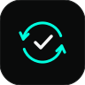

<div align="center">
  
  <br><br>
  <p>
    Luma brings the Humane Ai Pin's assistant, photos, notes, music, and<br>
    humane.center back, on a server you own.
  </p>
  <p>
    <a href="https://github.com/TheAndersMadsen/luma/releases/latest"></a>
    <a href="LICENSE"></a>
    <a href="https://github.com/TheAndersMadsen/luma/actions/workflows/ci.yml"></a>
    
    <a href="https://discord.gg/ZBVZHqJkpn"></a>
  </p>
  <p>
    <a href="#quick-start">Quick start</a> ·
    <a href="#connect-a-pin">Connect a Pin</a> ·
    <a href="docs/README.md">Docs</a> ·
    <a href="docs/faq.md">FAQ</a> ·
    <a href="#for-developers">Develop</a> ·
    <a href="https://discord.gg/ZBVZHqJkpn">Discord</a>
  </p>
</div>

> [!IMPORTANT]
> Luma is a free community project, not affiliated with or endorsed by Humane
> or HP. It is for people who own an Ai Pin and want to keep using it after
> Humane shut its service down on 28 February 2025. You are responsible for
> your device, your server, and the accounts you connect. See [NOTICE](NOTICE)
> and [TRADEMARKS.md](TRADEMARKS.md).

## Humane's cloud is gone. Yours isn't.

Luma rebuilds the Pin's cloud as software you run yourself. Your Pin talks to
**Cosmos**, the cloud on your server. You manage it all in **Center**, your
own humane.center. Your provider keys stay on the server; the Pin holds none
and talks to no one else.

<p align="center">
  
</p>

<table>
  <tr>
    <td align="center" valign="top" width="33%">
      
      <br><b>Ask it anything.</b><br>
      Voice questions, web search, weather, places and directions, calls,
      translation, Catch Me Up, and Vision.
    </td>
    <td align="center" valign="top" width="33%">
      
      <br><b>Every capture, in your Center.</b><br>
      Photos and videos with favorites, tags, search, and share links.
    </td>
    <td align="center" valign="top" width="33%">
      
      <br><b>Your music, by voice.</b><br>
      Spotify, YouTube Music, or TIDAL.
    </td>
  </tr>
  <tr>
    <td align="center" valign="top" width="33%">
      
      <br><b>humane.center, yours.</b><br>
      Notes, contacts, My Data, Memories, settings, and the Pin installer.
      <a href="docs/center.md">What your Center does</a>.
    </td>
    <td align="center" valign="top" width="33%">
      
      <br><b>Private by design.</b><br>
      Your keys never leave your server. The Pin holds none. No telemetry.
      <a href="docs/privacy.md">App privacy</a>.
    </td>
    <td align="center" valign="top" width="33%">
      
      <br><b>Keeps itself current.</b><br>
      Signed releases, verified before install, backed up first.
      <a href="#update-luma">Update Luma</a>.
    </td>
  </tr>
</table>

## Quick start

**One afternoon. No account.** You need a fresh Ubuntu 24.04 server (`amd64`
or `arm64`, 4 GB of RAM, ports 80 and 443 open, a public IPv4 address), a
domain name pointing at it, an assistant key for any OpenAI-compatible
service, and an Azure Speech key. Nothing else, and no GitHub account.
Starting from nothing? [Server from nothing](guides/server-from-nothing.md)
rents the server and a free domain with you, in about 1.5 hours. With a
server and a domain in hand, this takes about 30 minutes:

```sh
# 1. Download the latest signed release
mkdir -p ~/luma && cd ~/luma
curl -fsSL https://api.github.com/repos/TheAndersMadsen/luma/releases/latest \
  | grep browser_download_url | cut -d '"' -f 4 | xargs -n 1 curl -fsSLO

# 2. Check it, and unpack it where updates look for it
sha256sum --check SHA256SUMS
install -d -m 0700 ~/.local/share/luma ~/.local/share/luma/operators ~/.local/share/luma/build
tar -xzf luma-operator-*-linux.tar.gz -C ~/.local/share/luma/operators
cd ~/.local/share/luma/operators/luma-operator-*/

# 3. Install Bun and Docker, then set up and deploy
bash ./bootstrap --tools-only
./luma onboard production --pin-release-archive ~/luma/luma-pin-*.tar.gz
```

If `bootstrap` asks you to reconnect over SSH, do that, `cd` back into the
same folder, and run the last command. Setup ends with your Center's address.
Sign in with the details in `~/.config/luma/production/first-login.txt`, add
your keys in **Settings → Assistant & voice**, and
[connect your Pin](#connect-a-pin).

Every step, with the reason for each command, is in
[docs/install.md](docs/install.md). When a step doesn't match, it says what
went wrong and what is safe to retry; the fixes are in
[Troubleshooting](docs/troubleshooting.md).

### Get Luma

The Quick start is one of several ways in, and they all end in the same place.
[Server from nothing](guides/server-from-nothing.md) rents the server and the
domain with you, screen by screen. [docs/install.md](docs/install.md) has the
one-line installer and Hetzner cloud-init. On Umbrel OS, the community app
store [Perseu5/umbrel-apps](https://github.com/Perseu5/umbrel-apps) repackages
Luma; its packager builds their own images, so it is not this project's signed
release.

Releases and container images are public and signed, so installing and
updating need no account or token. A private fork passes a classic GitHub
token with the `repo` and `read:packages` scopes through the GitHub CLI or
`LUMA_GITHUB_TOKEN_FILE`, and `./luma registry login` saves one for updates.

## Configure services in Center

Two services make the Pin answer: an assistant model and Azure Speech.
Everything else is optional and can come later. Keys go in Center's settings
and stay in Cosmos; they never reach the Pin.

| Service | Needed? | Options |
| --- | --- | --- |
| Assistant | Yes | [OpenRouter](guides/providers/openrouter.md), [OpenAI API](guides/providers/openai-api.md), [another compatible API](guides/providers/openai-compatible.md), or a [Codex subscription](guides/providers/codex-subscription.md) |
| Speech | Yes | [Azure Speech](guides/providers/azure-speech.md) |
| Search | Optional | [SearXNG](guides/providers/searxng.md) (included) or [SerpAPI](guides/providers/serpapi.md), plus [Perplexity](guides/providers/perplexity.md) |
| Maps and places | Optional | [Google Maps](guides/providers/google-maps.md) |
| Weather | Optional | [Pirate Weather](guides/providers/pirate-weather.md) |
| Knowledge | Optional | [Wolfram\|Alpha](guides/providers/wolfram-alpha.md) |
| Food | Optional | [Open Food Facts](guides/providers/open-food-facts.md) |
| Music | Optional | [Spotify](guides/providers/spotify.md), [YouTube Music](guides/providers/youtube-music.md), [TIDAL](guides/providers/tidal.md) |
| Agent | Optional | [Rabbit OS3](guides/providers/rabbit-os3.md) |

The [provider setup guides](guides/providers/README.md) get you each key.
[Configure services in Center](docs/services.md) explains how they work
together.

## Connect a Pin

> [!WARNING]
> Installing Luma replaces what is on the Pin. Coming from PenumbraOS,
> FusionOS, or OpenPin? Back it up first:
> [Coming from another Ai Pin project](guides/connect-your-pin.md#coming-from-penumbraos-or-another-ai-pin-project).

**A cable, not a cloud.** Center installs Luma on the Pin from desktop Chrome
or Edge, over USB. Your Wi-Fi password and the apps travel over that cable and
never pass through the server. One Luma server serves one Pin, and the first
Pin you connect is reserved for it for good.

<p align="center">
  
</p>

### 1. Prepare and connect

You need the [PenumbraOS USB interposer](https://github.com/PenumbraOS/interposer),
which sits on the service contacts under the small moon sticker (see its
[preparation guide](https://github.com/PenumbraOS/interposer/blob/master/preparation.md)),
a USB-C **data** cable plugged straight into the computer, desktop **Chrome**,
**Chromium**, or **Edge**, the Pin charged, unlocked, and finished booting, and
your Wi-Fi name and password unless the Pin has a working mobile line.

Place the Pin on the interposer. In Center, open **Settings → Set up a Pin**,
choose **Connect over USB**, and continue only when the serial Center shows is
the one on your Pin. Linux USB permissions and other details are in
[docs/connect-a-pin.md](docs/connect-a-pin.md).

### 2. Follow Guided setup

Seven stages, each green only after Center has checked it on the Pin or on
your server. **Check again** reads everything again.

| Stage | What happens |
| --- | --- |
| 1. **Connect your Pin.** | You pick the Pin in the browser's USB prompt. |
| 2. **Network & time.** | The Pin joins Wi-Fi, and Center fixes its clock if needed. |
| 3. **Install Luma.** | **Open installer**, then **Install Luma VERSION**, installs the five Luma apps. Keep the tab open and the cable in while the Pin restarts. |
| 4. **Required services.** | Center checks the assistant and speech are ready. |
| 5. **Connect to your Luma.** | You choose a four-digit passcode, and the Pin is paired with your server. |
| 6. **Pin passcode.** | You enter the same four digits once more, and they go straight to the Pin. |
| 7. **Try it.** | You ask a question and confirm the microphone, speaker, and gesture work. |

### 3. Activate and prove the device

Keep the Pin on the cable and choose **Open Provisioning** in stage 5, then
**Connect this Pin to Cosmos**. Center reads the Pin's hardware ID, pairs it
with your account, creates its one-time identity, installs the Cosmos address
and trust roots, and checks the whole activation on that exact Pin. Back in
Guided setup, enter the same four digits under **Pin passcode**, choose
**Finish setup on this Pin**, ask the Pin one real question, and choose
**Confirm microphone, speaker & gesture**. The Pin keeps that confirmation
itself, tied to its serial, the installed release, and your server.

The **Create an activation file instead** section is a fallback for recovery or
headless activation. Normal setup stays in Center and needs no ADB commands or
private keys moved by hand. The [Connect your Pin guide](guides/connect-your-pin.md)
walks through every screen, including reconnecting, recovery, and mobile lines.

## Run your server

Center in the browser, `./luma` on the server. The reference is
[docs/operations.md](docs/operations.md).

### Update Luma

It updates itself. Every hour your server asks its update source for the
newest release. With automatic updates on, it installs it at night: download,
verify the maintainer's signature, back up, set up, deploy, verify. If that
fails after set-up, the backup goes back and the previous release runs again.
`./luma update production` does the same right away. See the
[Update guide](guides/update.md) and
[docs/operations.md](docs/operations.md#update-luma).

<p align="center">
  
</p>

### Back up and restore

`./luma backup production` copies everything Luma can't recreate. Take one
before any risky change. A backup restores only with the release that made it.
See [docs/operations.md](docs/operations.md#back-up-and-restore).

### Reset a lost password

You can reset the Center owner's password from the server. See
[docs/operations.md](docs/operations.md#reset-a-lost-password).

## The assistant runtime

The assistant runs in Cosmos, never on the Pin. Fixed requests take a direct
route in code. Everything else goes to your model inside one 70-second run, at
most 20 seconds per model step and eight actions per request, and the answer
always leaves before the deadline. A consequential action needs your exact
confirmation, and a locked Pin gets none. How it routes, its deadlines, and
its safety checks are in [docs/assistant.md](docs/assistant.md).

## For developers

Set up a checkout, run the checks, and add features that match the stock
Pin's behaviour. Start with [CONTRIBUTING.md](CONTRIBUTING.md). The reference
is [docs/developers.md](docs/developers.md), and [AGENTS.md](AGENTS.md) holds
the rules people and coding agents follow.

### Configuration

Every `LUMA_` and `COSMOS_` setting, where it lives, and what it changes:
[docs/developers.md#configuration](docs/developers.md#configuration).

### Stock reference

`./luma stock decompile` builds the decompiled stock apps outside the
checkout. They are the specification every stock behaviour cites:
[docs/developers.md#stock-reference](docs/developers.md#stock-reference).

### Build the Pin apps

Five apps, one signed set, built in the pinned container:
[docs/developers.md#build-the-pin-apps](docs/developers.md#build-the-pin-apps).

### Publish a release

`./luma release publish` builds, signs, and publishes a tagged release from
the maintainer's machine:
[docs/developers.md#publish-a-release](docs/developers.md#publish-a-release).

### Keep root access after reboot

The optional on-device root flag and the `./luma pin dock` helper, limited to
one attempt per boot:
[docs/developers.md#keep-root-access-after-reboot](docs/developers.md#keep-root-access-after-reboot).

## Troubleshooting

When a `./luma` or `bootstrap` step stops, it says what went wrong and what
is safe to retry. [docs/troubleshooting.md](docs/troubleshooting.md) lists
symptoms and fixes, the [Troubleshooting guide](guides/troubleshooting.md)
goes step by step, and the [glossary](guides/glossary.md) explains unfamiliar
words. Still stuck? Ask in the [reHumane Discord](https://discord.gg/ZBVZHqJkpn)
or open an [issue](https://github.com/TheAndersMadsen/luma/issues) with the
file `./luma support-bundle` writes. It leaves out your secrets.

## Community

The [reHumane Discord](https://discord.gg/ZBVZHqJkpn) is Luma's official
community: ask for help, share what works on your Pin, and follow new releases.

**Contributing.** Fixes, features that match the stock Pin, and clearer
documentation are all welcome. [CONTRIBUTING.md](CONTRIBUTING.md) covers the
checkout and the checks to run before a pull request. Two rules matter most:
stock APKs and decompiled stock code never enter the repository, and stock
`humane.*` names stay exactly as they are. The
[Code of Conduct](CODE_OF_CONDUCT.md) applies everywhere.

**Security.** Luma runs your cloud, so a security problem in Luma is a problem
on your server. Report one privately through GitHub's private vulnerability
reporting, never in a public issue. [SECURITY.md](SECURITY.md) says what to
include and what to expect.

## Credits and legal

Luma exists because of the work around [Penumbra](https://github.com/PenumbraOS)
and its [USB interposer](https://github.com/PenumbraOS/interposer), which make
a stock Ai Pin reachable again. The Pin apps, the Device Installer, and
Center's Pin-setup flow come from that PenumbraOS work and keep its MIT
licenses ([pin/LICENSE](pin/LICENSE),
[pin/device-installer/LICENSE](pin/device-installer/LICENSE)). The interface
uses [Inter](https://github.com/rsms/inter) under the SIL Open Font License,
and [NOTICE](NOTICE) lists every vendored component.

Luma is an independent reimplementation, built so Ai Pins their owners
lawfully possess keep working after Humane shut the original cloud down on
28 February 2025. It contains no Humane source code, firmware, binaries,
fonts, or design assets. The `humane.*` protocol names, Android package
identities, and the device's own build strings appear only where an unmodified
Pin needs them exactly. Luma is not affiliated with or endorsed by Humane or
HP. “Humane”, “Ai Pin”, “CosmOS”, and related marks belong to their owners and
are used only to describe compatibility. See [TRADEMARKS.md](TRADEMARKS.md).
