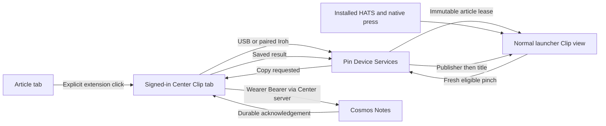

# Luma Gestures and Clip

Luma adds configurable finger shortcuts and browser-to-Pin Clip to the normal
launcher. The controls are in **Center → Settings → Pin → Gestures** and **Clip**.
Finger shortcuts are off by default. Clip only accepts an article after the
wearer explicitly enables browser handoff in the current Center tab.

This is experimental until validated on a physical Pin. Software checks do not
establish a 1:1 match to the supplied prototype video. The publisher mark persists
beside the title, as in the reference. Its exact
scale, typography, placement, animation and back-of-hand projection remain
unverified on hardware.

For installation and a repeatable device check, see [Try Gestures and Clip](../guides/gestures-and-clip.md).

## What was recovered

The stock reference lives outside the checkout; see [For developers](developers.md#stock-reference).
Tickle uses the installed HATS service, not extra camera or finger drivers. The
SDK copies its interpretation of the 25-point skeleton, five fingers,
palm-relative planes, five-sample calibration and 12 mm activation displacement.
Evidence: `humane.experience.tickle.gesture.Hand`, `FingerTracker.update`,
`TickleGestureService.FlatHandCallback.onHandTrackingSummary`, and
`humaneinternal.system.hats.FlatHandService.HandTrackingHandler.handleMessage`.

Native analysis of the locally recovered 1.3.0 firmware traced
`ndkhandtracking` → `ht_v2.so` → Android input and the HATS Binder summary:

- `PinchHandler::UpdateStates`, `ComputeVelocity` and `Update` use thumb/index
  distances, velocity history and movement/time gates. The implementation uses
  their existing Android press output through `ControlView.setupTouchHandling`
  and `Button2.pressedStateDidChange`, rather than a parallel pinch recognizer.
- `stateToAidlHandStateV2` aliases `detected`, `isHand` and `hasFlatHand` to a
  tracked state. `hasFlatHand` does **not** establish a usable projection. The
  summary also omits native pinch bits and landmark confidence and leaves some
  touch fields zero. Luma invents neither confidence nor live touch capabilities.
- Projection depends on native pose, mesh, overlap and depth gates.
  `MeshRendererImpl::onMeshLost` and `drawFrame` stop dynamic projection when the
  mesh is lost. Luma does not override those gates or replace the native callback.
  A back-of-hand pose must be checked on the actual unit.

Bindings, hysteresis, timing, Clip transport/persistence and the feature catalog
are Luma extensions (**INFERRED**). No original post, prototype code or explanation
was supplied. The video cannot establish OCR, whether the Mac supplied the
article, whether it ran on production hardware, or whether the copy persisted.
Luma deliberately implements an explicit semantic browser handoff.

## Execution and ownership

`pin/gesture-sdk` is a source library linked into the existing Compatibility
Layer and Device Services APKs. It adds no sixth APK. Device preferences live in
`Settings.Global.luma_launcher_gestures_v1`. Observations and Clip's current
article live in bounded Pin process memory. Cosmos alone persists the note.
Center holds the current draft and session in memory; the extension stores only
the owner's Center address. Neither gets a Pin admin token or a cloud provider key.

The launcher adds a summary subscription to its existing stock HATS callback on
the stock HATS worker. It never starts a camera, calls `triggerStart/Stop`, extends
tracking timeouts or takes control of laser safety. Eligibility requires focused,
unlocked, provisioned Home content, with its dashboard closed. Native projection
state and a finite, valid mesh gate recognition and copy requests. Sensor gaps,
hand changes, lifecycle changes, invalid settings and queue overflow cancel
pending recognition. Observation/copy Binder I/O runs on a bounded worker, never
the UI thread.

Device Services admits observations/copy requests only from the exact launcher
UID **and PID/process name**; UID alone is insufficient because stock apps share
UID 1000. Inspector reads, configuration and Clip endpoints use the existing
USB capability or authenticated Iroh path. The reviewed remote routes require
`GesturesRead` / `GesturesManage`; the default capability set remains empty.

## Shortcuts and the feature catalog

Curl the configured fingers, hold, then return to a neutral open hand for 150 ms.
Luma uses Tickle's five-sample calibration and 12 mm trigger, with an INFERRED
8 mm release threshold and 250–1500 ms configurable hold. The baseline stays
fixed during a projection session. Additional or unbound fingers cancel a pending
shortcut. Thumb, index, pinch selection and fist navigation retain stock roles.

| Feature ID | Trigger | Effect |
| --- | --- | --- |
| `open_music` | Finger hold and release | Opens stock Music |
| `open_messages` | Finger hold and release | Opens stock Messages; sends nothing |
| `open_settings` | Finger hold and release | Opens stock Settings; changes nothing |
| `pinch_to_copy` | Native press during an explicit Clip session | Saves the handed-off article to Notes |

A binding uses middle, ring, pinky or an exact combination. Duplicate or subset
bindings are refused, avoiding ambiguous partial chords. Configuration is strict
schema version 1, at most four bindings and 4096 UTF-8 bytes, with modes `off`,
`observe` and `active`. Observation mode recognizes and previews without opening
an app. Clip is a session feature, not an assignable finger shortcut.

Center reads the installed Pin's catalog and validates responses. Saves use a
configuration revision and read back the result. A stale editor receives 409;
a failed storage write never reports success. Changing Pins discards the draft.
The opt-in inspector shows copied XYZ landmarks, curled fingers, projection
availability, hold progress and the last result. Samples expire after one second.
At most 600 samples stay in tab memory and can be explicitly exported as JSON.
Exports contain motion coordinates, not camera images or article content, and
are labelled as observations rather than physical acceptance.

## Clip transaction and presentation

The Chromium extension uses `activeTab` and `scripting` for the article the wearer
explicitly chooses. It requests optional access only to the owner's Center host;
tab selection still checks the exact origin and `/settings/pin/clip` path. It
hands off title, publisher, URL and selected text, without activating the Center
tab, reading the rest of the page, taking a screenshot, fetching a remote URL,
or using OCR or a model. Center accepts only a validated same-window handoff
while enabled. There must be one Clip tab open.

Each handoff has an immutable UUID v4 and one 60-second ready lease. A different
article cannot replace it until cancelled, completed or expired. A fresh native
press in the dedicated full-surface Clip button requests the copy and consumes
that press so Home underneath cannot activate. Finger shortcuts are suspended
while this surface owns input. Tracking loss hides the presentation and restores
normal shortcut ownership; it cannot undo a note already saved.

The Pin changes the phase to `requested`; Center observes it over a device-paced
read loop that continues when the article tab is in front. Center calls
`PUT /capture/clips/{uuid}` through its server with the wearer's verified Bearer.
Cosmos inserts a normal note under its existing `(principal, uuid)` key. Concurrent
or repeated identical deliveries return the same note. A different payload at
that ID is a conflict, and another wearer cannot access the note. No stock proto
or database migration is needed. Selection text stays verbatim in the note;
article text never becomes an instruction to the assistant.

Only a valid Cosmos response with the same note UUID allows Center to acknowledge
`saved` to the Pin. Lost acknowledgements retry that same ID. Timeouts, disconnects
and malformed responses never become success. A request unconfirmed after 15 s
is labelled `unconfirmed`; the transaction expires 60 s after the request.
A browser tab that is closed, discarded, signed out or asleep cannot complete
this flow. Reopening Clip while its lease is live can reconcile a pending copy.
If it expires, check Notes before handing off the article again.

Presentation defaults inferred from the video: 500 ms after the press, show the
publisher mark; at 2500 ms show the title if saved, otherwise `Copying…`. While holding
the native press, pulling MCP joint 9 at least 35 mm nearer for 150 ms reveals an
excerpt (or the URL); 20 mm is the release hysteresis. Loss cancels the animation.
The mark stays above-left of the title in both phases. NYTimes URLs use a bundled
[Simple Icons 16.0.0 glyph](https://github.com/simple-icons/simple-icons/blob/16.0.0/icons/newyorktimes.svg)
inside the reference's circle; other sites use a circled publisher initial. The
source license ships in the APK. Publisher text cannot select the NYTimes glyph
for a different host. The stock font and projection surface are used. These values
are development starting points, not measured Pin-to-video equivalence.

## Luma API contracts

These are Luma-owned, INFERRED endpoints; stock `humane.*` messages are unchanged.

| Surface | Method and path | Contract |
| --- | --- | --- |
| Pin | `GET /api/gestures` | Config, SHA-256 revision, validity, installed catalog |
| Pin | `PUT /api/gestures` | `{revision, config}`; compare-and-set and read-back |
| Pin | `GET /api/gestures/observation` | `{observation: object or null}`; expires after 1 s |
| Pin | `GET /api/gestures/clip` | `{clip: object or null}`; response paced at 400 ms |
| Pin | `PUT /api/gestures/clip` | `{id, title, publisher, url, selection}` |
| Pin | `DELETE /api/gestures/clip` | `{id}`; only cancels a ready target |
| Pin | `PUT /api/gestures/clip/result` | `{id, outcome: saved or failed}`; exact pending target |
| Center | `PUT /api/capture/clips/{uuid}` | Same-origin authenticated note save |
| Cosmos | `PUT /capture/clips/{uuid}` | Verified web Bearer; idempotent note insert |
| Center | `GET /api/downloads/luma-clip` | Public, rate-limited source extension archive |

Title is nonblank and at most 256 code points, publisher 100, selection 12000,
URL at most 2048 UTF-8 bytes, and the whole HTTP request at
most 64 KiB. URLs must be HTTP(S), have a host, and contain no credentials or
whitespace. NULs, unknown fields and noncanonical IDs are refused. No server
fetches the URL. The Android settings bridge carries at most 64 KiB and uses its
existing private loopback token; article content is never written to logs.

## Extending the source SDK

`HandFrame` carries one copied tracked skeleton, monotonic receipt time and an
opaque native timestamp. `StockHandFrameReader.Sample.projectable` is separate
from tracking availability. `GestureEngine.accept(frame)` returns a match only
after hold and neutral release; `accept(null)` / `cancel()` discard a gesture.
`GestureConfig`, `GestureBinding`, `GestureFeatures` and `GestureObservation`
share the same schema between the launcher and Device Services. `ClipMotion`
handles presentation of an already recognized native press, not pinch detection.

For a new feature, first specify failure and physical acceptance cases. Add its
typed catalog entry and direct dispatch in `LauncherGestureHooks`, citing the
stock entry point or marking it INFERRED. Keep actions inside their existing
feature owners. A new recognizer can consume `HandFrame`; lifecycle, eligibility,
mesh validity and cancellation stay with the launcher adapter. Read-only preview
must work before enabling side effects. There are no downloadable executable
modules, arbitrary package/shell/URL targets or binary SDK compatibility promise.
A cloud capability belongs in Cosmos with its normal authorization and policy.

## Verification scope, written before implementation

The integrated version strengthens the existing device settings path. The SDK
owns configuration and the feature catalog; Device Services owns persistence
and the live, in-memory observation; Center edits through its existing Pin
client. No cloud flag, downloaded code, replacement driver, or extra APK is
needed. New configuration and inspection endpoints are Luma APIs (INFERRED).

Before implementing those boundaries, the acceptance cases are:

- An unauthenticated caller, another Android process, or an unreviewed remote
  route cannot read motion data or configure actions.
- A stale editor cannot overwrite a newer configuration. Failed write/read-back
  cannot return success. Invalid settings remain recoverable by turning off.
- The catalog comes from the installed Pin; an unavailable action, arbitrary
  executable target, extra field, oversized request, or invalid chord is refused.
- Observations expire after a stopped launcher, stalled sensor, or disconnect.
  A configuration change, pause, lock, lost projection, or queue overflow cancels
  pending actions and projected feedback. An inspector never interprets stale
  frames as a successful gesture.
- Switching Pins or leaving the page aborts pending reads and discards the old
  Pin's draft and observations. Failed saves retain the draft and say why.
- Preview feedback is drawn through the stock UI inside its existing projection
  surface. No Luma code overrides laser safety, native mesh eligibility, or the
  stock native callback owner.
- The prototype's back-of-hand pose and inward pull must pass separately on the
  physical Pin. A synthetic replay or an open-palm shortcut is not that evidence.

Clip acceptance, specified before the implementation: an explicitly handed-off
article has one immutable UUID, bounded title/publisher/URL/selection, and a short
device lease. Only that lease's native pinch can request a copy. A replacement
target, expiry, wrong ID, stale frame, hand loss, or lifecycle change cannot copy
a different article. A native press in Clip must not activate Home underneath.
The launcher displays success only after Cosmos confirms persistence. Duplicate
deliveries and concurrent retries create one note; different content under the
same ID is a conflict; one wearer cannot read or overwrite another's note.
Invalid URLs, credentials in URLs, unsupported schemes, NULs, oversized input,
unverified web callers and cross-site writes are refused before persistence.
A browser disconnect, late save acknowledgement, or server failure must leave
an explicit pending/failure result rather than a fabricated successful copy.

The first replay must exercise the complete path from synthetic stock-shaped
summary objects through landmark validation and recognition to the action ID.
It is an isolated software check, not evidence about the sensor or projector.
Failure cases to cover:

- Bad, missing, non-finite, truncated, ambiguous two-hand, or non-projectable
  samples; degenerate geometry; input arrays changed after delivery.
- Calibration while the hand moves, a new hand, a lost hand, stalled or reversed
  timestamps, a long delivery gap, and a queued sample from a previous session.
- Threshold jitter, slow movement, a brief curl, a long hold, repeated callbacks,
  and tracking loss mistaken for a deliberate release.
- Pinch/fist or an unbound combination overlapping a configured gesture; an
  action firing before a stable open-hand release or firing twice.
- Missing, malformed, oversized, unknown-version, duplicate, or conflicting
  configuration; unsupported actions and existing thumb/index controls.
- Activity pause, loss of focus, navigation away from Home, keyguard, incomplete
  onboarding, subscription failure, and native-service death. These last
  lifecycle and Binder cases also require an installed-build physical check.

The Android/JVM check produces a JUnit report in the external build directory.
A physical acceptance record must separately name the serial, firmware, signed
release, configured gestures, hand used, attempts, unintended activations,
recognition/action latency, and the cases above. A software pass cannot replace
that record.

## Repeatable software evidence

Run `./luma pin check`, `./luma check center`, `./luma check cosmos`,
`./luma check platform --full`, `./luma test`, and `git diff --check`.

- Launcher replay: stock-shaped summaries → reader → SDK → allowlisted action,
  plus native-press presentation replay. Fixtures are synthetic, not sensor data.
- Device acceptance: configuration/storage conflict, caller admission, observation
  expiry, immutable Clip lease, duplicate presses and late acknowledgements.
- Center: actual pane/PinClient contract tests, abort on device change, explicit
  handoff, no pre-press save and no false acknowledgement.
- Packaged extension: actual archive source executed against simulated browser
  APIs; verifies optional host grant and an unchanged article tab. It writes an
  archive and `acceptance.json` in an external `luma-clip-acceptance-*` temporary
  directory, with its SHA-256 and `physical_pin_verified: false`.
- Cosmos: authenticated HTTP copy, concurrent retries, content conflict and
  partition isolation against memory and the throwaway Postgres database.
- Iroh: exact method/path/capability/body limits at the Pin and bridge boundaries.

Pin JUnit reports and `runtime/android/build/reports/gestures/device-acceptance.json`
are under the external pinned builder worktree, not in source. A successful
build creates installable software; the owner's physical acceptance in the guide is
still required for any claim of 1:1 reproduction.
